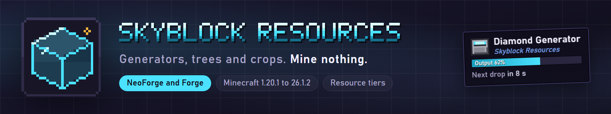

# Skyblock Resources

Resource generators, tree generators and crop generators for skyblock packs. Each machine has a tier from stone up to netherite, and an upgrade card moves it up one tier in place.



## Supported versions

| Minecraft | NeoForge | Forge |
|---|---|---|
| 26.3 | yes | yes |
| 26.2 | yes | yes |
| 26.1.2 | yes | yes |
| 1.21.1 | yes | yes |
| 1.20.1 | yes | yes |

Forge and NeoForge are separate builds. On 1.20.1 a Forge build also runs on NeoForge, but from 1.21.1 on each loader needs its own build.

## Build

Each build is its own Gradle project under `versions/<minecraft>/<loader>`. To build one:

```bash
cd versions/mc26.1.2/neoforge
./gradlew build
```

The jar is written to that project's `build/libs` folder.

## Repository layout

- `common/`: data and assets, written once and shared by every build
- `versions/`: one Gradle project per Minecraft version and loader
- `overrides/`: per-version and per-loader changes to the shared data, such as mod recipes that differ between loaders
- `tools/`: the Gradle script that builds each version's data from `common/`
- `docs/`: porting notes and recipe rules
- `branding/`: logo, banners and store listing copy
- `MOD_MATRIX.md`: which mods have plant and block recipes, and for which versions
- `PROJECT_STATUS.md`: current status and open checks

## Reporting issues

Use the issue templates on GitHub. Include your mod version, loader, Minecraft version and the relevant log lines.

## License

GPL-3.0.
