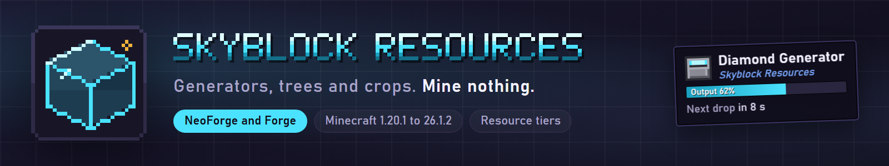

# Skyblock Resources listing kit: CurseForge and Modrinth

Everything you need to fill in the two project forms. Files are in `branding/icon/` and `branding/banners/`.

## Project fields

| Field | CurseForge | Modrinth |
|---|---|---|
| Project ID | _fill in_ (not in the repository yet) | _fill in_ |
| Name | Skyblock Resources | Skyblock Resources |
| Slug / URL | `skyblock-resources` | `skyblock-resources` |
| Icon / logo | `icon/icon_512.png` (square, at least 400x400) | `icon/icon_512.png` (square, under 256 KiB) |
| Class | Mods | Mod |
| Main category | Map and Information or Utility; pick one | Utility |
| Loader | NeoForge, Forge | NeoForge, Forge |
| Game versions | Set on each uploaded file | Set on each uploaded file |
| Environment | Client and server | Client and server |
| License | GPL-3.0 | GPL-3.0 |
| Source | https://github.com/ItMeCasey/skyblock-resources | same |
| Issues | https://github.com/ItMeCasey/skyblock-resources/issues | same |

Replace `skyblock-resources` with the GitHub repository name, which is not set in the project yet.

### One-line description

> Generators, trees and crops that turn one block of dirt into a resource engine, from stone up to netherite.

### Summary

Modrinth (256 characters max):

> Resource generators, tree generators and crop generators for skyblock packs. Upgrade any machine a tier in place with an upgrade card. Supports NeoForge and Forge.

CurseForge (keep it short; it shows on cards):

> Generators, trees and crops that turn one block of dirt into a resource engine.

### Gallery

| File | Use |
|---|---|
| `banners/features.png` (1920x1080) | Featured gallery image on Modrinth, first image on CurseForge |
| `banners/social.png` (1280x640) | GitHub social preview (repo Settings > Social preview), second gallery image |
| `banners/banner.png` (800x150, saved at 2x) | Top of both descriptions |
| `banners/h_*.png` (800x46, saved at 2x) | Section headers inside the descriptions |

The panels in these images are illustrations drawn for the branding, not game screenshots. Add real in-game screenshots to the gallery once the machines have been checked in a client.

### Image links in the descriptions

The descriptions below load images from the GitHub repository, so they only show once `branding/` is pushed and the repository is public. If it stays private, upload the images to the project gallery (Modrinth) or Images tab (CurseForge) and swap in those links.

---

## Description (Modrinth, Markdown)

```markdown


**Generators, trees and crops that turn one block of dirt into a resource engine, from stone up to netherite.**

Skyblock Resources adds resource generators, tree generators and crop generators to skyblock packs. Each machine runs on its own tier, and you upgrade it in place when you are ready for more.


- **Resource generators:** stone, iron, diamond and netherite. Each tier makes more, faster.
- **Tree generators:** plant a sapling and the tree grows into a resource tree, with the drops set by the tier.
- **Crop generators:** wheat and produce from other food mods. Crops keep their own growth timers.
- **Upgrade cards:** sneak and click a generator, tree or crop with the matching card to move it up one tier. It keeps its stored data.
- **Recipes in KubeJS:** tree and crop drops are plain data, so a pack can add or change plants with a script.


- Install it on the client and the server. It works in singleplayer and on multiplayer servers.
- Place a generator, feed it the matching block or sapling, and collect what it makes.
- Upgrade cards work on any generator of the tier below. Sneak and click to upgrade in place.


Minecraft 1.20.1, 1.21.1 and 26.1.2, on NeoForge and Forge. Download the file for your loader and version from the Files tab.


**Does it need to be on the server?** Install it on both. The client needs it to show the machines and the server needs it to run them.

**Can I change the drops?** Yes. Tree and crop drops are recipes, so a pack can add or change plants with KubeJS.

**License:** GPL-3.0. Source and issues on [GitHub](https://github.com/ItMeCasey/skyblock-resources).
```

## Checklist

1. Fill in the `skyblock-resources` placeholder and the project IDs, after the GitHub repository name is set.
2. Push `branding/` to GitHub (and make the repository public) so the description images load.
3. Create the Modrinth project: name, slug, summary, icon, categories, environment, license, links, description. Upload `features.png` as the featured gallery image.
4. Create the CurseForge project the same way, with `icon_512.png` as the logo. CurseForge reviews new projects before they go live, so it needs a first file uploaded.
5. Set `banners/social.png` as the GitHub social preview.
6. Before publishing, check the claims in the description in a client: the tiers, upgrade cards and install lines. The status file lists the live-client checks still open.
7. Optional: add `icon/skyblock_logo.png` to the jar as the mod list logo (`logoFile` in `mods.toml`, file in the resources folder).
