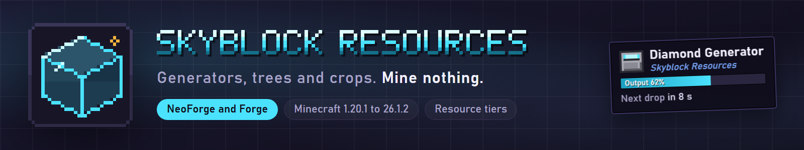

**Generators, trees and crops that turn one block of dirt into a resource engine, from stone up to netherite.**

Skyblock Resources adds resource generators, tree generators and crop generators for skyblock packs. Each machine has a tier, and you upgrade it in place when you are ready for more.

- **Resource generators:** stone, iron, diamond and netherite. Each tier makes more, faster.
- **Tree generators:** plant a sapling and it grows into a resource tree. The drops depend on the tier.
- **Crop generators:** wheat and produce from other food mods, each with its own growth timer.
- **Upgrade cards:** sneak and click a generator, tree or crop with the matching card to move it up one tier. It keeps its stored data.
- **Recipes in KubeJS:** tree and crop drops are plain data, so a pack can add or change plants with a script.

- Install it on the client and the server.
- Place a generator, feed it the matching block or sapling, and collect what it makes.
- Sneak and click with an upgrade card to move a machine up one tier in place.

Minecraft 1.20.1, 1.21.1 and 26.1.2, on NeoForge and Forge. Download the file for your loader and Minecraft version from the Files tab.

All of these are optional. The mod loads and works with none of them installed.

- **Recipe viewers:** Barely Enough Items (all six builds), REI (26.1.2 NeoForge, 1.21.1 NeoForge, both 1.20.1 builds), EMI (1.21.1 NeoForge, both 1.20.1 builds) and JEI (every build that has JEI). They show resource generator outputs, tree drops, crop drops and soil types, with every generator as a workstation.
- **In-world info:** Show Me What This Is (all six builds) and Jade (NeoForge 26.1.2, NeoForge 1.21.1, both 1.20.1 builds) show what a generator is working on and how far along it is.
- **KubeJS:** typed recipe schemas for soil types, tree drops and crop drops.

**Tested:** Barely Enough Items was checked in a client on all six builds (resource generator, tree drop, crop drop and soil type cards). Jade was checked on all four builds that have it, and Show Me What This Is on all six. REI, EMI and JEI were not checked in a client; they compile and load only when installed.

**Does it need to be on the server?** Install it on both. The client needs it to show the machines, and the server needs it to run them.

**Can I change the drops?** Yes. Tree and crop drops are recipes, so a pack can add or change plants with KubeJS.

**License:** GPL-3.0. Source and issues on [GitHub](https://github.com/ItMeCasey/skyblock-resources).
